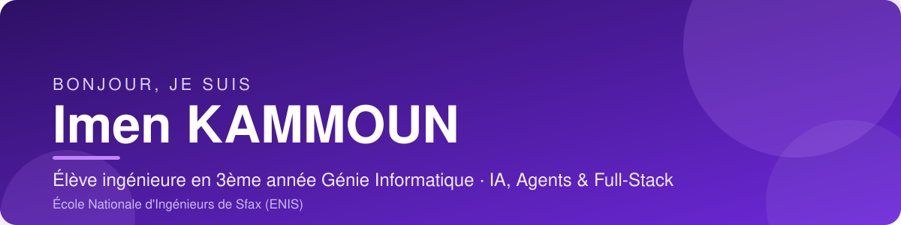

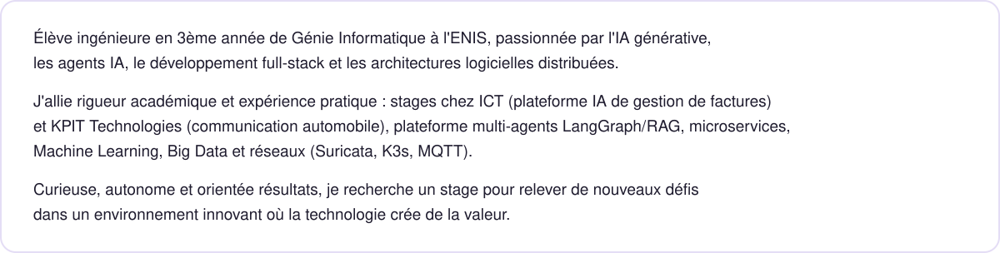

<!-- TODO: remplacer par le lien du dépôt ICT (seulement si l'entreprise l'autorise) -->
<a href="https://github.com/kammounimen?tab=repositories">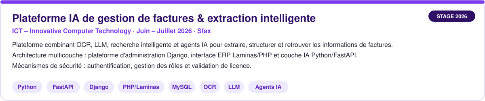</a>

<a href="https://github.com/kammounimen/FogWatch">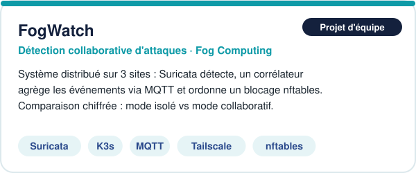</a>
<a href="https://github.com/kammounimen/langGraph">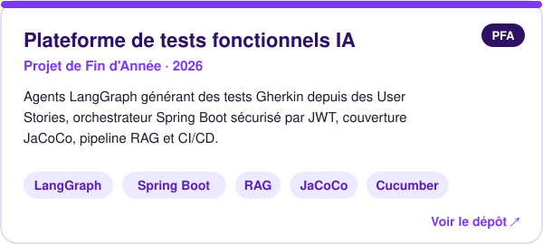</a>
<!-- TODO: remplacer par le dépôt de l'agent BI -->
<a href="https://github.com/kammounimen?tab=repositories"></a>
<a href="https://github.com/kammounimen/projet_ml_retail"></a>
<!-- TODO: remplacer par le dépôt Hadoop -->
<a href="https://github.com/kammounimen?tab=repositories"></a>
<!-- TODO: remplacer par le dépôt du simulateur KPIT (si autorisé) -->
<a href="https://github.com/kammounimen?tab=repositories"></a>


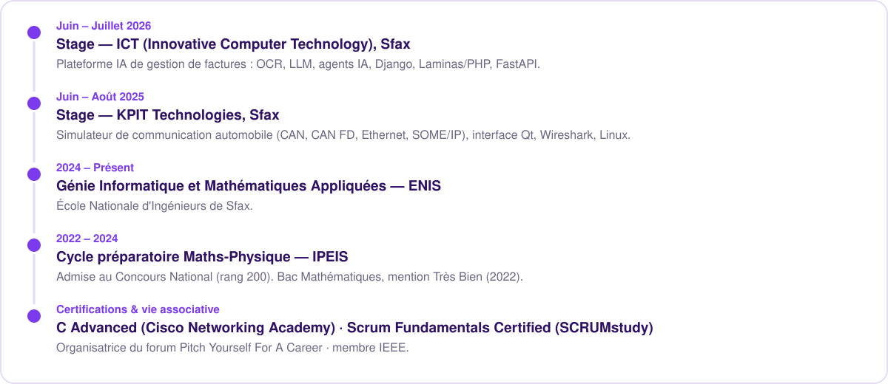


