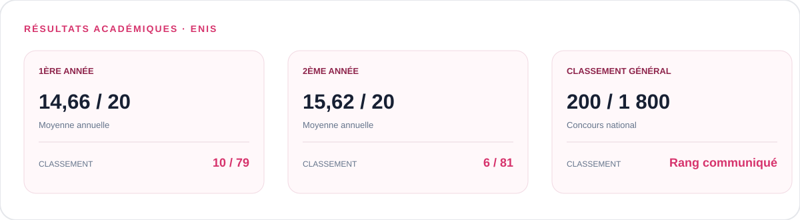
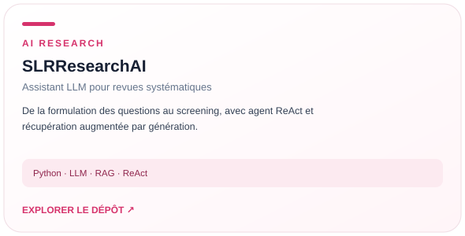
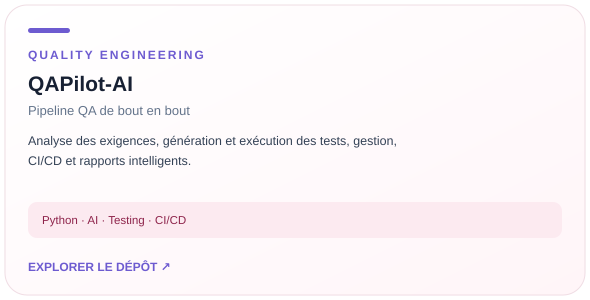
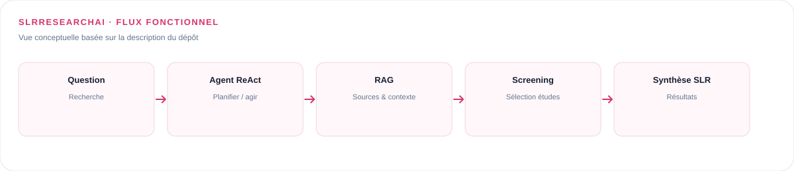
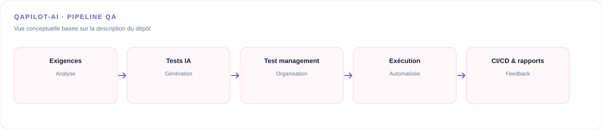
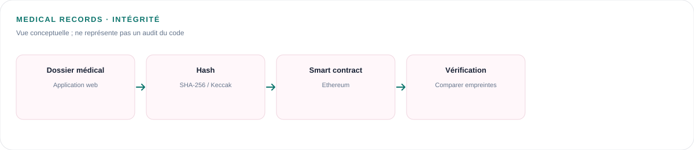
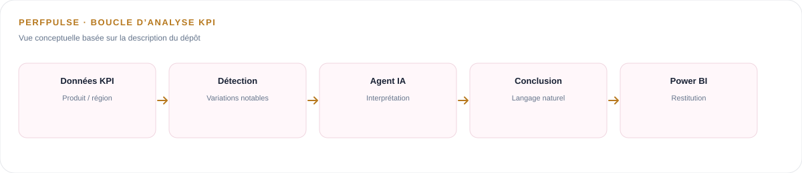
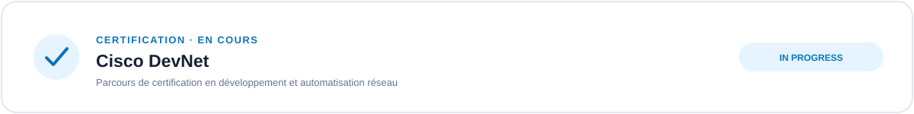

## 🎓 Parcours académique

Élève ingénieure en **Génie Informatique et Mathématiques Appliquées à l’ENIS**, avec un intérêt pour l’IA générative, les agents intelligents, l’ingénierie logicielle et les systèmes distribués.

---

## 🚀 Projets à la une

### Autres projets

---

## 🧩 Schémas d’architecture

Ces schémas résument les flux fonctionnels à haut niveau à partir des descriptions des projets. Ils ne remplacent pas la documentation technique détaillée des dépôts.

### SLRResearchAI

### QAPilot-AI

### Medical Records Blockchain Integrity

### PerfPulse — Agent IA & Business Intelligence

---

## 🛠️ Compétences techniques

**QA & Software Engineering :** conception de tests, automatisation, gestion des tests, CI/CD, architectures microservices.

**Blockchain :** Ethereum, Solidity, Hardhat, MetaMask, ethers.js, hachage SHA-256/Keccak.

**IA & Data :** LLM, RAG, agents ReAct, LangChain, LangGraph, OCR, Python, Hadoop et Power BI.

---

## 🧭 Parcours

---

## 📜 Certifications & engagement

### En cours

---

## 📬 Contact

